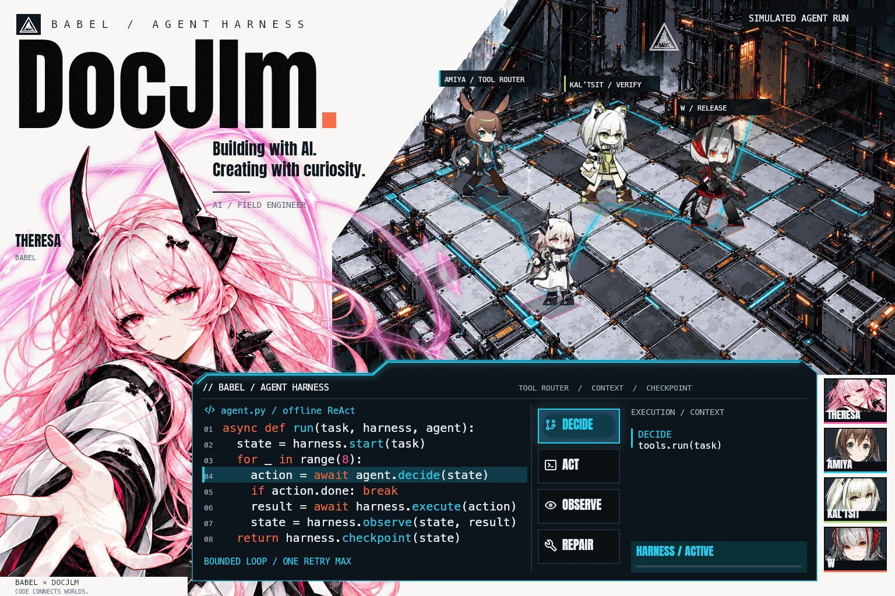

<picture>
  <source media="(max-width: 600px) and (prefers-reduced-motion: reduce)" srcset="assets/harness/babel-harness-mobile.png">
  <source media="(prefers-reduced-motion: reduce)" srcset="assets/harness/babel-harness-desktop.png">
  <source media="(max-width: 600px)" srcset="assets/harness/babel-harness-mobile.gif">
  
</picture>

 

01 / THE PERSON BEHIND THE CODE

### Hi, I'm DocJlm.

A hobbyist programmer building a company and working as a **Forward Deployed Engineer**, helping businesses put AI to work.

I feel fortunate to be creating in a time of extraordinary progress in AI.

**[Explore my personal world ↗](https://www.zqcblog.com/)**

 

02 / BEYOND THE CODE

### Same curiosity. Different worlds.

**CREATE** &nbsp; Vibe Coding · Poetry · Music Composition · Video Creation 
**LIVE** &nbsp; Music · Basketball · Travel 
**PLAY** &nbsp; Arknights

BABEL / AGENT HARNESS — Theresa contains and repairs; Amiya calls tools; Kal’tsit verifies; W releases. A fan-made ReAct story with original game-model animation and illustrated scenery. <a href="CREDITS.md">Models & artwork credits</a>.

 

---

03 / SMALL STEPS, EVERY DAY

### Contribution Trails

A little curiosity, leaving a trail.

<picture>
  
</picture>

 

04 / BUILT ONE COMMIT AT A TIME

### A City Built Over Time

Small things, patiently built, become a world.

<picture>
  <source media="(max-width: 600px)" srcset="https://raw.githubusercontent.com/DocJlm/DocJlm/output/city-mobile.svg">
  
</picture>

 

---

If you're curious about what I'm building, you're welcome to join me.

Inspired by Theresa and the world of Arknights. Character artwork © Hypergryph. <a href="CREDITS.md">Artwork & credits</a> · Contributions rendered with <a href="https://github.com/Platane/snk">snk</a> and <a href="https://github.com/yoshi389111/github-profile-3d-contrib">3D Contrib</a>.
